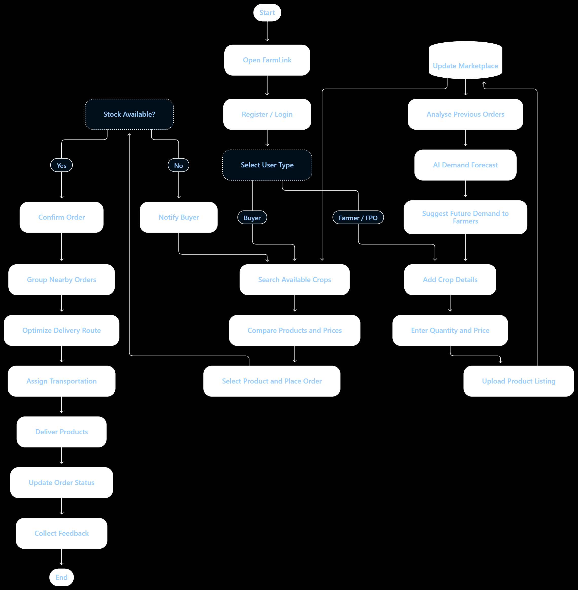

# Smart India Hackathon Workshop
# Date: 25.11.2026
## Reference Number:26002950
## Name: G Sanjana Sakthi 

## Problem Title
SIH 26033: Multiple intermediaries reduce farmers earnings and increase consumer prices.

## Problem Creater's Organization
Ministry of Consumer Affairs, Food & Public Distribution

## Theme
Agriculture, FoodTech & Rural Development

## Problem Description
Expected Solution: Create a digital marketplace that:

• Connects farmers/FPOs directly with consumers and bulk buyers.
• Provides logistics support.
• Uses AI for demand forecasting and route optimization.

Benefits:

• Better prices for farmers.
• Lower prices for consumers.
• Reduced supply chain inefficiencies.

## Proposed Solution
# FarmLink

###  1. Detailed Explanation of the Proposed Solution

We propose a digital platform called **FarmLink**, which connects farmers, Farmer Producer Organizations (FPOs), consumers and bulk buyers through a single marketplace.

Farmers can register on the platform and upload details of their available crops, quantity, quality and expected price. Buyers can view the products, compare prices and purchase directly from farmers without depending on multiple intermediaries.

The platform will also include a smart logistics system that groups orders from nearby locations and helps arrange suitable transportation. This will reduce unnecessary trips and delivery expenses.

An AI-based demand forecasting feature will analyse previous orders and seasonal demand to estimate which crops may be needed in the coming days. Based on this information, farmers can plan their supply more effectively.

###  2. How It Addresses the Problem

- **Direct Selling:** Reduces the dependency on multiple intermediaries by connecting farmers directly with buyers.
- **Price Transparency:** Allows buyers to compare prices and farmers to decide their selling prices.
- **Smart Transportation:** Groups nearby orders to reduce transportation expenses and delivery time.
- **Demand Forecasting:** Helps farmers understand market demand and avoid producing or supplying excess quantities.
- **Order Tracking:** Allows both farmers and buyers to check the status of their orders.

### 3. Innovation and Uniqueness of the Solution

The main uniqueness of FarmLink is that it combines direct agricultural trading with shared logistics and demand prediction in one platform.

- **Nearby Order Grouping:** Orders from nearby buyers can be combined to make better use of vehicle space.
- **Smart Route Planning:** Suggests efficient delivery routes based on buyer locations and vehicle capacity.
- **Demand-Based Suggestions:** Uses past sales and seasonal patterns to estimate future demand.
- **Small Farmer Support:** Allows small farmers to list their products individually or through an FPO.
- **Transparent Transactions:** Keeps product prices, order details and delivery updates visible to the users.

The platform focuses not only on selling agricultural products but also on improving the way they reach consumers.

## Technical Approach

### 1. Technologies i use here

| Technology | Purpose |
|---|---|
| Python | Backend development and AI implementation |
| HTML, CSS, JavaScript | Frontend development |
| Flask | Connecting frontend and backend |
| SQLite / MySQL | Storing user, product and order details |
| Pandas, NumPy | Processing agricultural and order data |
| Scikit-learn | Basic demand forecasting model |
| Maps API | Location-based delivery and route planning |

### FLOW CHART OF MY IDEA

### 2. Methodology and Process for Implementation

The platform will work through the following stages:

1. **User Registration:** Farmers, FPOs and buyers create their accounts.
2. **Product Listing:** Farmers enter crop details, available quantity and expected price.
3. **Product Discovery:** Buyers search for crops and compare available prices.
4. **Order Placement:** Buyers select products and place their orders.
5. **Order Grouping:** The system identifies nearby orders that can be transported together.
6. **AI Demand Prediction:** Previous sales and seasonal information are analysed to estimate future demand.
7. **Route Optimization:** The system suggests a suitable delivery route based on locations and vehicle capacity.
8. **Delivery and Feedback:** Orders are delivered, their status is updated and users can provide feedback.

For the initial prototype, we will use sample agricultural data and a basic forecasting model. Later, the platform can be improved using real market data and more advanced AI models.

## Feasibility and Viability

### 1. Analysis of the Feasibility of the Idea

FarmLink can be developed using commonly available software technologies and does not require expensive hardware.

- The platform can be accessed through smartphones and computers.
- Farmers can use a simple interface to upload their products.
- Buyers can place orders and track deliveries online.
- Existing map services can be used for route planning.
- Basic AI models can be developed using Python libraries.

The initial version can be developed with a limited number of farmers, buyers and products before expanding to larger agricultural markets.

### 2. Potential Challenges and Risks

- Some farmers may not be familiar with digital platforms.
- Internet connectivity may be limited in rural areas.
- Crop availability and prices may change frequently.
- Transportation arrangements may be difficult for small quantities.
- Accurate demand prediction may be difficult when historical data is limited.

### 3. Strategies for Overcoming These Challenges

- Provide a simple interface with regional language support.
- Allow FPOs or local coordinators to help farmers register and list products.
- Allow farmers to update crop availability and prices whenever required.
- Combine nearby orders to make transportation more economical.
- Start with basic demand prediction and improve its accuracy as more order data becomes available.
- Verify farmer and buyer accounts to improve trust and reliability.

## Impact and Benefits

### 1. Potential Impact on the Target Audience

FarmLink mainly benefits farmers, FPOs, consumers, retailers and bulk buyers.

- **Farmers:** Get direct access to buyers and better opportunities to earn a fair price.
- **FPOs:** Can manage products from multiple farmers and reach more customers.
- **Consumers:** Can purchase agricultural products at more reasonable prices.
- **Retailers and Bulk Buyers:** Can find products from different farmers in one place.
- **Logistics Providers:** Can receive grouped delivery requests and plan transportation efficiently.

### 2. Benefits of the Solution

**Economic Benefits**
- Reduces dependency on multiple intermediaries.
- Helps farmers retain a better share of the selling price.
- Reduces unnecessary transportation expenses.

**Social Benefits**
- Supports small and local farmers.
- Encourages digital participation in agriculture.
- Improves direct communication between farmers and buyers.

**Environmental Benefits**
- Reduces unnecessary delivery trips through order grouping.
- Helps improve vehicle utilization.
- Can reduce fuel consumption and transport-related emissions.

**Overall Benefit**

FarmLink aims to create a more transparent and efficient agricultural supply chain where farmers receive better selling opportunities and consumers get access to reasonably priced products.
## Research and References
https://enam.gov.in/web/?utm_source=chatgpt.com

https://www.india.gov.in/category/agriculture-rural-environment/subcategory/agricultural-produce/details/website-of-agmarknet?utm_source=chatgpt.com

https://ondc.org/?utm_source=chatgpt.com

https://www.pib.gov.in/PressReleasePage.aspx?PRID=2204750&lang=1&reg=1&utm_source=chatgpt.com